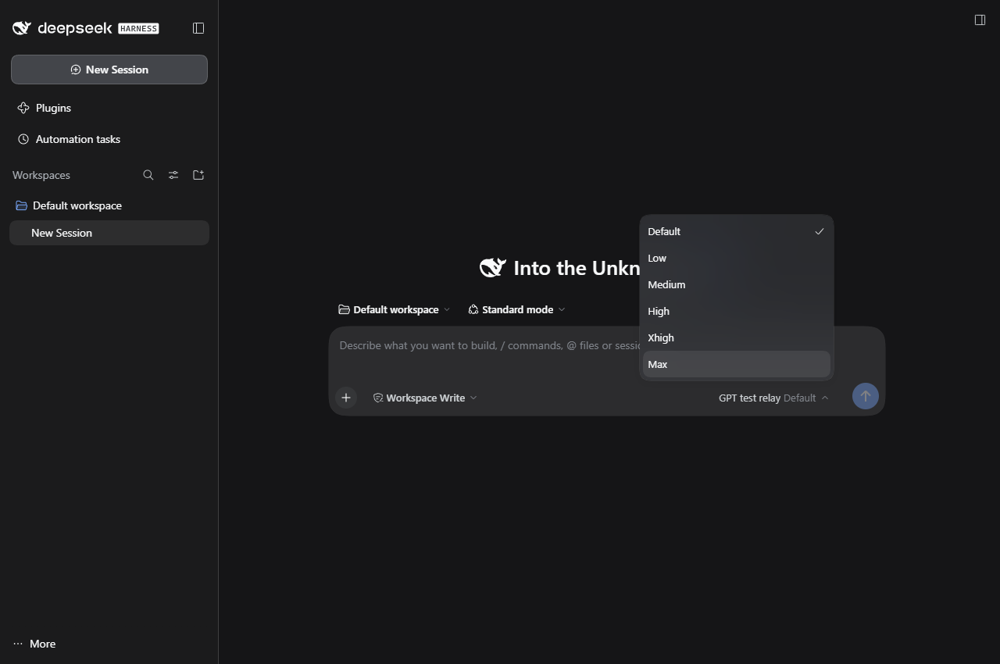
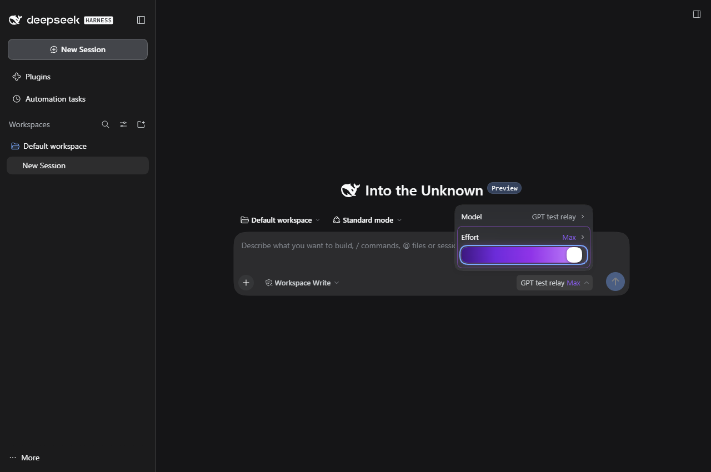

# DSH Third-Party Model Reasoning Effort: Automatic Level Matching

[中文](README.md) | English

## Summary

**Automatically match reasoning-effort levels to connected third-party models, adapting the available options when you switch or add models.**

Provider and model IDs are matched against DSH's bundled catalog to enable native effort controls for third-party OpenAI-compatible models, with gateway-specific overrides. Matching uses local metadata, not live gateway probing; unknown models receive no guessed levels.

Use it independently, or pair it with [dsh-codex-effort-slider](https://github.com/Microqian2th/dsh-codex-effort-slider) for a slider with gradients, particles, and animations. Verified with DSH Desktop `0.2.1-rc.2`.

## Contents

- [Install and use](#use)
- [Pair with the visual slider](#slider)
- [Configuration](#configuration)
- [Implementation and development](#development)
- [Related projects](#related)
- [Model experience](#model-experience)
- [Known limitations](#limitations)

-----

<a id="use"></a>
## Install and use

Download `dsh-model-thinking-0.2.0.tgz` from [Releases](https://github.com/yxccai/dsh-model-thinking/releases). Add this local package through DSH Desktop's plugin manager, then fully exit and reopen DSH. This is a standalone plugin; the slider plugin is optional.

Click the model name in the chat composer → Effort → select a level. Your selection applies to the next request; the native menu supports third-party models without a slider.



The screenshot comes from an isolated DSH Web profile using a local test alias. Requests only reach a local mock gateway. Desktop uses the same model menu.

Installation adds the `dsh-model-thinking` profile layer. Disabling or removing it restores the original declared capabilities; DSH retains effort selections in existing sessions, so select Default when necessary. The plugin overlays runtime capabilities without rewriting provider configuration files, API keys, or session history.

-----

<a id="slider"></a>
## Pair with the visual slider

For a more visual control, optionally install [Microqian2th/dsh-codex-effort-slider](https://github.com/Microqian2th/dsh-codex-effort-slider). It adds a draggable slider, gradient colors, and stardust animations to the native effort selector. Follow that project's installation instructions.

| Plugin | Responsibility |
| --- | --- |
| `dsh-model-thinking` (this project) | Fill in missing third-party model effort levels and provide gateway parameter overrides. |
| `dsh-codex-effort-slider` (optional) | Read existing DSH effort levels and display an animated slider to select them. |

These are separate plugins, with no merged code or required dependency. The slider reads the levels supplied by this plugin; using this plugin alone retains the native DSH menu.



Five-level and six-level models were tested together with slider version `1.1.3`. The slider and visual effects in the screenshot belong to that project; its code is not included here.

-----

<a id="configuration"></a>
## Configuration

Automatic matching is enabled by default. Precedence is: explicit model declaration (including opt-out) → first matching override rule → installed DSH catalog → explicitly configured fallback for unknown GPT IDs. Only missing `reasoningEfforts` in `models` or `modelOverrides` are enriched, for `openai-completions` and `openai-responses` routes.

To customize a gateway, add this to the active profile's `cordis.patch.yml`:

```yaml
- id: dsh-model-thinking
  config:
    autoCatalog: true
    defaultEfforts: []
    rules:
      - provider: my-gateway
        model: gpt-6-*
        efforts:
          low: low
          medium: medium
          high: high
          xhigh: xhigh
          max: ultra
```

`provider` and `model` support `*` wildcards. `max: ultra` is only an example of a gateway-specific wire value; use it only when your gateway requires `ultra`. Values are the strings sent in requests. Selector level names are `off`, `minimal`, `low`, `medium`, `high`, `xhigh`, and `max`.

| Setting | Meaning |
| --- | --- |
| `autoCatalog` | Default `true`; match the installed DSH catalog, reading an upgraded catalog on the next startup. |
| `defaultEfforts` | Default `[]`; explicitly set fallback levels for unknown GPT IDs, rather than detected capabilities. |
| `rules` | Default `[]`; match a provider/model pair to effort levels and request parameter values. |
| `autoGpt` | Legacy compatibility switch; takes precedence over `autoCatalog` when set. |

`off: none` explicitly sends `none`; `off: null` omits the parameter and does not guarantee disabled reasoning. Default in the menu uses the gateway default and also does not mean disabled reasoning. Model-level `reasoningEfforts: false` and an effective `supportsReasoningEffort: false` remain authoritative.

-----

<a id="development"></a>
## Implementation and development

Requires Node.js `>=22.19.0`. Build from source:

```sh
npm ci --ignore-scripts
npm run check
npm test
npm run build
npm pack --ignore-scripts
```

The 15 unit tests cover catalog matching, five/six levels, unknown IDs, explicit opt-outs, override precedence, and configuration immutability. GitHub Actions runs type checks, unit tests, the build, and packaging.

<details>
<summary>Implementation and local integration tests</summary>

[cordis.patch.yml](cordis.patch.yml) inserts a host plugin. [src/index.ts](src/index.ts) overlays capability declarations onto the pi-ai adapter's effective configuration. [src/catalog.ts](src/catalog.ts) reads the installed pi-ai catalog; [src/capabilities.ts](src/capabilities.ts) handles precedence and mappings. There is no client UI bundle; DSH still owns effort persistence and request serialization.

`scripts/test-installed.mjs` uses the real Loader, LLM service, and pi-ai adapter to verify request parameters, configuration updates, unload restoration, and prepared calls. `scripts/test-web.mjs` boots an isolated real Web profile and uses system Edge to check the native menu, slider, and submitted parameters. They require a local DSH installation, are excluded from generic CI, and make no paid model calls.

Both scripts take the installed `app.asar/dsh` directory as their first argument and run under Desktop Electron with `ELECTRON_RUN_AS_NODE=1`. The Web test accepts `DSH_TEST_MODEL`, `DSH_TEST_EFFORT`, `DSH_TEST_SLIDER_PATH`, and `DSH_TEST_PLUGIN_PATH`; its five/six-level assertions currently use the fixture model IDs specified in the script.

</details>

-----

<a id="related"></a>
## Related projects

- [DeepSeek Harness](https://github.com/deepseek-ai/deepseek-harness): the host application.
- [dsh-codex-effort-slider](https://github.com/Microqian2th/dsh-codex-effort-slider): optional slider and visual effects.
- [MIT License](LICENSE) and [third-party notices](THIRD_PARTY_NOTICES.md).

<a id="model-experience"></a>
## Model experience

This plugin adds no tools, system prompts, or model calls. It passes the selected reasoning effort through the existing DSH path; the pi-ai adapter serializes Chat Completions and Responses requests.

<a id="limitations"></a>
## Known limitations

Automatic matching reads a local capability catalog rather than querying a gateway for its live capabilities. Unknown or ambiguous model IDs receive no extra levels by default. Catalog metadata cannot guarantee that a gateway forwards all parameters; use override rules for gateway-specific restrictions. Renamed models, aliases, and stale catalogs can also prevent matching.

The verified runtime is DSH Desktop `0.2.1-rc.2`. Compatibility depends on its Cordis configuration mechanism and pi-ai exports; other DSH versions require separate verification. Enabling or disabling the plugin reloads the pi-ai adapter. Prepared requests retain the parameters from when they started.

### Dev Note

<details>
<summary>Working context for maintainers</summary>

None.

</details>
